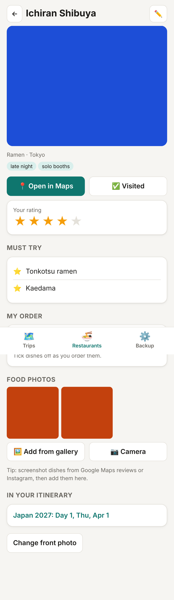

# Wayfare

A personal travel planner that lives on your Android phone and works offline.

- **Trips**: a page for each day, with timed plans and map links.
- **Restaurants**: a photo of the front, must-try dishes, your order list, food photos, tags, rating, visited.
- **Search and sort** by name, dish, city, cuisine, trip, rating.
- **Share from Google Maps** straight into a new restaurant.
- **Backup** everything (photos included) to one file.

All your data is stored only on your phone. This repository holds just the app's code.

## Install on your phone
1. Open https://nidheesh9726-wq.github.io/wayfare/ in Chrome on Android.
2. Tap ⋮ → **Install app** (or **Add to Home screen**).

## Updating the app
After changing files, bump `VERSION` in `sw.js` so phones pick up the new version.

